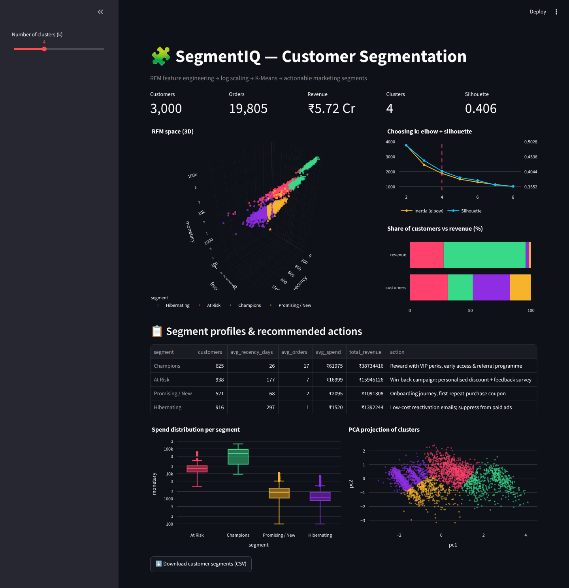
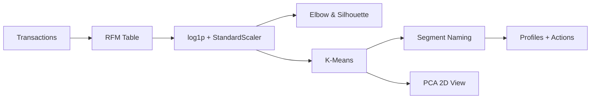

<div align="center">

# 🧩 SegmentIQ — Customer Segmentation with RFM & K-Means

**Turn raw order history into actionable customer segments — Champions, At Risk, Promising, Hibernating.**

    

`Data Science · Unsupervised Learning`

</div>

---



## 📌 Problem Statement

Marketing teams waste budget sending the same campaign to every customer. Segmentation lets them target the right message to the right group.

## ✨ Key Features

- **RFM feature engineering** (Recency, Frequency, Monetary) from transaction logs
- Log-transform + standard scaling to handle heavy-tailed spend
- **Elbow + silhouette** analysis to choose *k* (interactive slider)
- Automatic, rule-based **segment naming** and recommended marketing action
- 3D RFM scatter, PCA projection, spend box-plots, customer vs revenue share
- Download every customer with their segment as CSV

## 🏗️ Architecture



## ⚙️ How It Works

1. ~20,000 orders from 3,000 customers are simulated with hidden behaviour patterns.
2. RFM table is built per customer, `log1p` transformed and standardised.
3. K-Means (k-means++, 20 inits) clusters customers; silhouette score measures separation.
4. Clusters are named by a value score (F + M − R) and a frequency × recency quadrant.

## 🧰 Tech Stack

| Layer | Tools |
|---|---|
| Language | Python 3.10+ |
| ML / Logic | pandas, numpy, scikit-learn |
| UI & Visualisation | Streamlit, Plotly |

## 📁 Project Structure

```
CUSTOMER-SEGMENTATION-RFM/
├── app.py             # Streamlit dashboard
├── segmentation.py    # Data simulation, RFM, k-search, clustering, naming
├── assets/              # screenshots
├── requirements.txt
└── README.md
```

## 🚀 Getting Started

```bash
git clone https://github.com/PreciousBharath/CUSTOMER-SEGMENTATION-RFM.git
cd CUSTOMER-SEGMENTATION-RFM
python -m venv venv && source venv/bin/activate   # Windows: venv\Scripts\activate
pip install -r requirements.txt
streamlit run app.py
```

Open **http://localhost:8501** in your browser.

> The project ships with a realistic built-in demo dataset, so it runs out of the box with no downloads or API keys.

## 🗺️ Roadmap

- [ ] Customer Lifetime Value (BG/NBD) model
- [ ] DBSCAN / GMM comparison
- [ ] Push segments to email marketing tools

## 👨‍💻 Author

**Bharath** — Software Developer · Project Engineer · Technical Trainer

[](https://linkedin.com/in/connectbharath)
[](https://itsbharathportfolio.netlify.app)
[](https://github.com/PreciousBharath)

⭐ If this project helped you, please give it a star!

## 📄 License

Released under the [MIT License](LICENSE).
